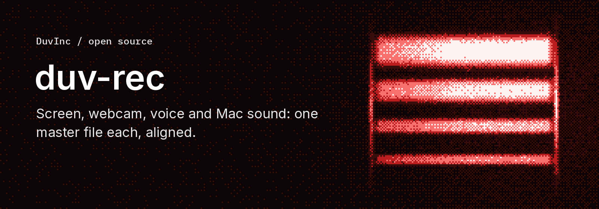

# Duv Rec



**Your screen recorder saved the voice as 64 kb/s AAC and the 4K webcam as 1080p. No edit gets that back.**

Duv Rec is a small macOS app that records the screen, the webcam, the microphone and the Mac's sound, each into its own file, at master quality, all starting and ending on the same instant. It only captures: no editor, no export, no network. The files go straight into your editor or your own pipeline.

```
~/Movies/Duv Rec/2026-11-18_19-25-03/
├── screen.mov     the screen or a drawn area, native Retina size, HEVC, pointer drawn in
├── camera.mov     the webcam up to 4K 30 fps, HEVC
├── mic.wav        the voice, 48 kHz, 32-bit float, uncompressed
├── system.wav     the Mac's sound, if turned on
└── session.json   settings, devices, frames written and dropped, pauses, status
```

Measured on a 45-minute take (Retina screen at 60 fps, Insta360 Link 2C Pro in 4K, RØDE NT-USB Mini): **81,011 camera frames, none dropped, no hole in the voice, microphone clock off by 32 ms over the whole take.** About a quarter of one CPU core and 105 MB of memory while recording, because the encoding runs on the Mac's media engine.

## Why it exists

Screen Studio recorded a 39-minute shoot with the microphone as AAC 64 kb/s mono and the webcam as HEVC capped at 1080p (0.65 Mb/s), whatever the hardware plugged in. Those two tracks were the quality ceiling of the film, and no processing recovers them. Editing is solved elsewhere; capture was the weak link.

## How a take works

```
             host clock ─────────────────────────────────────────────────────────▶
                              T0                                            T1
ScreenCaptureKit  screen   ···│██████████████████████│      │███████████████│···   screen.mov
                  sound    ···│██████████████████████│pause │███████████████│···   system.wav
AVCaptureSession  camera   ···│██████████████████████│ cut  │███████████████│···   camera.mov
                  voice    ···│██████████████████████│ out  │███████████████│···   mic.wav
                              └ every file starts here      every file ends here ┘
```

- **One clock.** `T0` is set half a second after every source is flowing. Every track is cut to the same window of the host clock, `[T0, T1]`: a video file opens at `T0` exactly (the screen repeats its current picture if nothing moved), an audio track drops the samples before `T0`, sample-exact. The files line up as they are, with no offset to apply.
- **A pause is cut out, not recorded.** Nothing is written between Pause and Resume, everything after is moved earlier by the time paused. One continuous file per track, still aligned.
- **Holes are filled, not skipped.** A late first buffer or a microphone that hiccups for more than 20 ms gets silence, so the voice keeps the take's clock instead of sliding earlier. Each fill is counted in `session.json`.
- **A crash loses seconds, not the take.** Video is written in fragments every 2 s, the WAV header is rewritten every second. After a `kill -9` mid-take, 12.0 s were readable on every track without a decode error.

Rejected: rotating files every N minutes. Same safety, plus seams to rejoin. Also rejected: an editor. Every app that records and edits trades capture quality for a smaller project file.

## Try it locally

You need macOS 14 or newer and Swift 5.9 or newer: Xcode, or only the Command Line Tools (`xcode-select --install`). There is no downloadable build: the app is not notarized, so you build it yourself.

```bash
git clone git@github.com:DuvInc/duv-rec.git
cd duv-rec
scripts/setup-signing.sh     # once: a local signing identity, so macOS keeps the permissions across rebuilds
scripts/install.sh           # build, sign, install /Applications/Duv Rec.app, launch it
```

macOS asks for the camera and the microphone at launch. Screen recording is granted in System Settings > Privacy & Security > Screen & System Audio Recording, and only takes effect after a relaunch: the app says so and offers to relaunch itself.

Without `setup-signing.sh`, the build is signed ad hoc, which macOS treats as a new app every time: it asks for every permission again after each rebuild.

## A take

1. **Three tiles, one per source: Screen, Camera, Sound.** The dot on a tile turns that source on or off (a take can be camera and voice only). Clicking a tile shows its settings below.
   - **Screen**: a whole display (without the menu bar if you want) or an **area** you draw: drag the corners and edges, move it from inside, Return to confirm. During the take a thin red frame surrounds the area, outside the recorded picture. Pointer, visible clicks (macOS 15), 30 or 60 fps. **Screen light** turns a second display plain white, a fill light for your face: never the recorded display, an external one first, and it works with the Screen source off. Click the white to turn it off.
   - **Camera**: preview, device, 4K or 1080p.
   - **Sound**: the microphone with its level meter (aim for peaks between −18 and −6 dB), and the Mac's sound as a separate track.
   - **Footer**: the take folder (`~/Movies/Duv Rec` by default), the free space, and the quality: Standard, High or Maximum.
2. **Start recording.** The window disappears: during a take nothing of the app is on screen, and its own windows are excluded from the capture anyway. The menu bar shows a red dot and the time; its menu has **Pause** / **Resume**, **Stop** and **Restart from zero** (the take goes to the Trash and a new one starts with the same settings).
3. **Stop.** The window comes back and the take's folder opens in the Finder.

Default devices: a camera plugged in by USB or Thunderbolt over the built-in one, never a virtual camera; a USB microphone over the system default, but not a webcam's own microphone. A device picked by hand is remembered, and taken back as soon as it is plugged in again.

The app refuses to start a take when a source is on but not delivering (a camera still starting, an unplugged microphone) or when less than 5 GB is free, stops cleanly under 2 GB, and keeps the Mac and the display awake during a take.

## Putting it in your workflow

The files are ordinary. What matters for a pipeline, in order:

1. **No sync step.** Every track starts at the same instant and has the same duration (within a few milliseconds). Lay them on a timeline at zero.
2. **Delay the voice against the webcam.** Webcams deliver their picture late; this app does not guess by how much. Measured with a clap on an Insta360 Link 2C Pro: the hands meet 50 to 84 ms after the sound, so delay `mic.wav` by about 70 ms against `camera.mov`. Against the screen, no delay.
3. **Microphone drift.** A USB microphone runs on its own crystal. `samples / (duration × sample_rate)` tells you by how much (−9 and −8 ppm measured, inaudible; 50 ppm would be 90 ms over 30 minutes). Resample if it matters to you.
4. **Interrupted takes.** If `status` is `recording`, the app did not stop cleanly. The files are readable up to the last fragment, but the counts in `session.json` are up to 10 s old: use the shortest track as the duration and do not compute a drift from them.

A camera-plus-voice file, picture copied, voice lossless, with the webcam delay:

```bash
ffmpeg -i camera.mov -i mic.wav -map 0:v -map 1:a -c:v copy \
  -af "adelay=70:all=1" -c:a alac -shortest rush.mov
```

`session.json`, the contract:

```json
{
  "app": "Duv Rec 0.2.0",
  "status": "complete",
  "started_at": "2026-11-18T18:25:03Z",
  "t0_host": 267599.343,
  "t1_host": 268053.116,
  "duration": 453.773,
  "pauses": 0,
  "paused_seconds": 0,
  "tracks": {
    "screen": { "file": "screen.mov", "width": 3020, "height": 1718, "fps": 60, "codec": "hevc", "quality": 0.85,
                "mode": "region", "region_points": [0, 121.7, 1510.2, 858.9], "display": "Built-in Retina Display",
                "cursor": true, "frames": 25159, "dropped": 0 },
    "camera": { "file": "camera.mov", "width": 3840, "height": 2160, "fps": 30, "codec": "hevc", "quality": 0.75,
                "device": "Acme 4K Webcam", "frames": 13614, "dropped": 0 },
    "mic":    { "file": "mic.wav", "format": "wav float32 mono", "device": "Studio USB Mic", "sample_rate": 48000,
                "samples": 21780945, "first_sample_host": 267599.343, "gaps_filled": 0 },
    "system": { "file": "system.wav", "format": "wav float32 stereo", "sample_rate": 48000, "samples": 21780960, "gaps_filled": 0 }
  }
}
```

`duration` excludes the pauses. A track that was turned off is absent from `tracks` and from the folder.

## What it costs, measured

| Take | Result |
| :--- | :--- |
| 45 min, Retina screen at 60 fps, Insta360 4K, RØDE, High | 81,011 camera frames, all 32 to 35 ms apart, none dropped on camera or screen, no audio gap, mic clock 12 ppm slow (32 ms over 45 min); 27 to 29% of one core, memory 107 MB then 66 MB (no leak); the Mac stayed awake with nobody at it |
| 5 min, same sources | 9,011 camera frames all 33 ms apart, 12,751 screen frames, none dropped, tracks within 2 ms, mic −9 ppm; 19 to 25% of one core, 105 MB |
| 7.5 min, Retina area at 60 fps, Insta360 4K, RØDE | 13,614 camera and 25,159 screen frames, none dropped, no gap, mic −8 ppm |
| 12 s with a 5 s pause, four tracks | 9.320 s on every track; camera frames 33 ms apart across the pause |
| `kill -9` mid-take | 12.0 s readable on camera, screen and mic |
| Same sources against Screen Studio, 75 s each | Duv Rec ≈ 42% of one core, Screen Studio ≈ 50% (+7% on WindowServer). Both encode on the media engine, so the quality level barely changes the load |

## Quality levels, and how to pick your own

Encoding is HEVC at constant quality (`AVVideoQualityKey`, 0 to 1): the encoder spends what each picture needs, so the file size follows the scene, not a fixed bitrate.

| Level | Camera | Screen | Camera 4K, measured | Camera 4K per hour |
| :--- | :--- | :--- | :--- | :--- |
| (Screen Studio, for reference) | 0.60 | | ≈ 6 Mb/s | ≈ 3 GB |
| **Standard** (default) | **0.75** | 0.85 | 24 Mb/s, VMAF 94.1 | 8 to 11 GB |
| High | 0.85 | 0.85 | 48 Mb/s, VMAF 96.4 | 20 to 29 GB |
| Maximum | 0.90 | 0.90 | 82 Mb/s, VMAF 97.2 | about twice High |

Screen, voice and Mac sound cost the same at every level: about 1 GB, 0.7 GB and 1.4 GB per hour.

**How these were chosen.** 12 s of an Insta360 Link 2C Pro in 4K were captured uncompressed in a dim room, then the same frames were encoded at each level and scored against the original with VMAF (0.65 gave 90.3, 0.80 gave 95.4). A difference becomes visible around 6 VMAF points. Then a blind test: the same 10 s at the four levels above, Screen Studio's included, shuffled and converted to one neutral format. In normal playback the viewer could not tell them apart, and a 100% crop of the face showed nothing between Standard and High.

**Why Standard and not lower.** The camera picture is not watched as recorded. It is cropped (a webcam window in a 4K master shows part of the frame at about full size), sometimes colour graded (which lifts noise and blocking in the shadows), then encoded twice more, by your editor and by the platform. Each step adds its losses to the recording's. Standard keeps a margin of about 4 points above the visible threshold for half the size of High. Take High or Maximum for a shot you will crop hard on a face.

**The light decides the size.** At constant quality, sensor noise is detail the encoder keeps: the same camera at High went from 45 Mb/s in daylight to 65 Mb/s in a dim room. A lamp on your face makes the file smaller and the picture better.

**Refining them for your camera.** The levels are three numbers in `Quality` ([`Sources/DuvRec/Session.swift`](Sources/DuvRec/Session.swift)). To measure your own:

1. Capture a short reference of your camera without compression, in your usual light, moving a little. Check it has no dropped frame: writing raw 4K to disk is often too slow, and the first test here froze for 1.5 s and lost a frame every half second. ProRes HQ kept up.
2. Encode those same frames at each candidate quality with VideoToolbox HEVC, the encoder the app uses.
3. Score each against the reference: `ffmpeg -i candidate.mov -i reference.mov -lavfi libvmaf -f null -`.
4. Watch them blind, on the same moment, zoomed on eyes and the darkest part of the background.

Compare candidates on frames, never on file sizes after conversion: a heavily compressed file can come out larger in ProRes, because its block edges are expensive to re-encode.

## What this is not

- **Not an editor.** No zooms, no cursor smoothing, no backgrounds. That is the next tool's job.
- **Not a downloadable app.** Not notarized; you build and sign it locally.
- **Not a window recorder.** A whole display or a drawn area, not one window.
- **Not a webcam controller.** Exposure and white balance stay in the camera's own software.
- **No bitrate cap.** Constant quality means a noisy picture costs more; there is no ceiling to stop it.
- **Not tested** on an Intel Mac, with two displays, or on a disk that really fills up mid-take.

## For developers and agents

```bash
scripts/test.sh                                   # 16 tests, no device, no permission
open -a "Duv Rec" --args --test-take 20           # a 20 s take with the saved settings, no clicking
```

`--test-pause <s>`, `--test-stop-paused`, `--test-restart` and `--pick-region` drive the other paths the same way; every measurement above was taken like this. [AGENTS.md](AGENTS.md) holds the layout and the rules, [docs/IMPLEMENTATION.md](docs/IMPLEMENTATION.md) the design, the measurements and 22 pitfalls met on the way, in the order they bit.

## Credits

Built on Apple's ScreenCaptureKit, AVFoundation and VideoToolbox, no third-party dependency. MIT licence. Contributions: [CONTRIBUTING.md](CONTRIBUTING.md).
